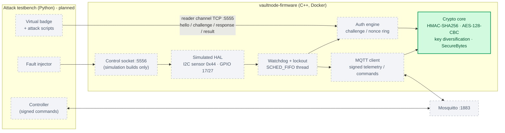

# VaultNode

**Encrypted RFID Access Controller & Server Room Telemetry Firmware: a simulated embedded-security project in C++ and OpenSSL, built and tested entirely in Docker.**

VaultNode is firmware for a server-room door node that authenticates RFID badges with a challenge-response protocol, watches temperature, humidity and an enclosure tamper switch, and reports signed telemetry over MQTT. There is no physical microcontroller: hardware is simulated so the whole system can be built, attacked and measured in containers. This repository is being built in phases, and this README describes only what exists today.

> **Project status: in progress (foundation + crypto core complete).**
> Done: the protocol specification, a hardened CMake build, and the cryptographic core with its test suite.
> Not yet built: the authentication engine, simulated hardware, MQTT, lockout logic and the attack testbench (see [Roadmap](#roadmap)).

---

## Architecture

The diagram shows the **planned** system. Solid green nodes are implemented; dashed grey nodes are planned and do not exist yet.



---

## What's implemented now

| Area | What exists | Where |
|---|---|---|
| **Protocol specification** | Wire formats, the normative verification order, the lockout state machine, MQTT signing rules, and known-answer test vectors that both the C++ firmware and the Python testbench must reproduce. | [`docs/PROTOCOL.md`](docs/PROTOCOL.md) |
| **Hardened build** | C++17 with extensions off, `-Wall -Wextra -Werror`, `-fstack-protector-strong`, `_FORTIFY_SOURCE=2`, PIE, full RELRO and BIND_NOW. Optional ASan/UBSan build. CMake refuses to configure on non-Linux hosts. | [`CMakeLists.txt`](CMakeLists.txt), [`firmware/CMakeLists.txt`](firmware/CMakeLists.txt) |
| **Crypto core** | HMAC-SHA256 and AES-128-CBC with PKCS7 padding (OpenSSL EVP APIs only), per-badge key diversification, constant-time comparison, CSPRNG wrapper, strict hex codec, the `SecureBytes` key container that wipes on destruction, and a single uniform decrypt-failure result. | [`crypto.hpp`](firmware/include/vaultnode/crypto.hpp), [`crypto.cpp`](firmware/src/crypto.cpp) |
| **Test suite** | A small header-only test harness. It covers protocol vectors, RFC 4231 and NIST SP 800-38A vectors, round trips, tampering and malformed input. | [`firmware/tests/`](firmware/tests/) |

`vaultnode-firmware` itself is currently a **stub entry point**. It prints its version and its linked library versions, then exits. None of the network services exist yet.

---

## Threat model

| Threat | Mitigation | Status | Proven by |
|---|---|---|---|
| Ciphertext tampering in a badge response | Encrypt-then-MAC: HMAC-SHA256 over `uid ‖ fw_nonce ‖ iv ‖ ct` | **Implemented** (primitives) | `tamper_flip_any_ct_bit_breaks_mac`: flips every single bit of the ciphertext and requires the MAC to fail each time |
| Cloned badge UID | Per-badge keys derived from a master key: `K = HMAC(MASTER, label ‖ uid)`. A copied UID without the right key cannot produce a valid MAC. | **Implemented** (primitives) | `tamper_other_mac_inputs_break_mac` (cloned UID with the wrong master key), `protocol_6_1_key_diversification` |
| Padding oracle | Every decrypt failure returns the same `nullopt`, with the partial plaintext wiped and OpenSSL's error queue cleared. The protocol requires the MAC to be checked *before* decryption. | **Partial**: uniform failure implemented; MAC-before-decrypt ordering belongs to the planned auth engine | `tamper_bad_padding_single_failure` |
| Timing side channel on MAC comparison | `constant_time_equal` via `CRYPTO_memcmp` | **Implemented** | `constant_time_equal_semantics` (functional correctness only; timing has not been measured) |
| Key material left in memory | `SecureBytes`: non-copyable, wiped with `OPENSSL_cleanse` on destruction and move-assignment | **Implemented** | `secure_bytes_move_semantics` and `static_assert`s on copy/move traits (the wipe itself is not observable from a test) |
| Weak or failed randomness | `RAND_bytes` with its return value checked; the code throws (fails closed) rather than using predictable nonces | **Implemented** | `secure_random_lengths_and_uniqueness` |
| Malformed or wrong-length input | Strict hex (charset, even length, exact length) and length checks on every key, IV and ciphertext | **Implemented** | `hex_decode_strict`, `aes_rejects_bad_key_lengths`, `aes_rejects_bad_iv_lengths`, `aes_decrypt_rejects_bad_ciphertext_lengths`, `derive_rejects_bad_lengths` |
| Replay of a captured badge response | Single-use 5 s challenges, a seen-nonce ring buffer, a ±5 s timestamp window | Planned | — |
| Reader impersonation | Mutual authentication: the firmware returns a `proof` the badge verifies | Planned (the proof computation itself is vector-tested in `protocol_6_1_firmware_proof`) | — |
| MQTT command forgery / replay | HMAC-signed commands, strictly increasing `seq`, ±30 s timestamp window | Planned (signature computation is vector-tested in `protocol_6_2_signed_commands`) | — |
| Physical enclosure tamper | Tamper GPIO → high-priority lockout thread → relay and signed alert | Planned | — |
| Thermal sabotage | Temperature/humidity thresholds → latched lockout | Planned | — |

---

## Protocol overview

The full specification, including field formats, verification order and test vectors, is in **[docs/PROTOCOL.md](docs/PROTOCOL.md)**. In summary:

- **Reader channel (TCP 5555, newline-delimited JSON):** `hello` → `challenge` (16-byte nonce) → `response` (AES-128-CBC ciphertext + HMAC-SHA256) → `result`. The firmware checks the MAC first, then decrypts, then checks the nonce is single-use, then checks the timestamp is fresh. Every failure gets the same `"denied"` response, so an attacker learns nothing about which check failed.
- **MQTT (1883):** telemetry and commands are HMAC-signed over a canonical string, with separate command and telemetry keys. Signed telemetry uses no floats (temperatures are fixed-point integers), so C++ and Python produce byte-identical signatures.
- **Lockout:** a tamper or thermal breach latches the node into `LOCKED_OUT` until a signed `unlock` arrives, and the unlock is refused while the condition is still active.

---

## Quick start (what works today)

The project builds only on Linux (it uses `eventfd`/`SCHED_FIFO`), so everything runs in a throwaway container. From the repository root:

```bash
docker run --rm -v "$PWD":/src -w /src ubuntu:24.04 bash -c "\
  apt-get update && \
  apt-get install -y build-essential cmake pkg-config libssl-dev libmosquitto-dev nlohmann-json3-dev && \
  cmake -S . -B /tmp/build && cmake --build /tmp/build && \
  ctest --test-dir /tmp/build --output-on-failure && \
  /tmp/build/firmware/vaultnode_tests"
```

For the sanitizer build, configure with `-DVAULTNODE_SANITIZE=ON`. To leave the unauthenticated simulation control socket out of the build entirely, use `-DVAULTNODE_SIM_CONTROL=OFF`.

To regenerate every metric in this README, run `scripts/measure_foundation.sh`. It also runs in a throwaway container. There is no Docker Compose stack or Makefile yet; both are on the roadmap.

---

## Project structure

```
.
├── .github/workflows/          (empty; CI is planned)
├── attack-testbench/           Python testbench (placeholder files only)
│   ├── tests/
│   ├── vaultnode_sim/__init__.py
│   ├── Dockerfile              (placeholder)
│   └── requirements.txt
├── benchmarks/
│   └── foundation_metrics.txt  raw output behind every number in this README
├── docs/
│   └── PROTOCOL.md             protocol specification + test vectors
├── firmware/
│   ├── include/vaultnode/
│   │   ├── build_info.hpp
│   │   ├── control_socket.hpp  (stub; simulation builds only)
│   │   └── crypto.hpp
│   ├── src/
│   │   ├── build_info.cpp
│   │   ├── control_socket.cpp  (stub)
│   │   ├── crypto.cpp
│   │   └── main.cpp            (stub entry point)
│   ├── tests/
│   │   ├── test_build_info.cpp
│   │   ├── test_crypto.cpp
│   │   ├── test_harness.hpp
│   │   └── test_main.cpp
│   ├── CMakeLists.txt
│   └── Dockerfile              (placeholder)
├── mosquitto/mosquitto.conf    (placeholder)
├── scripts/
│   └── measure_foundation.sh   regenerates benchmarks/foundation_metrics.txt (in Docker)
├── .env.example                dev-only, deliberately fake keys
├── CMakeLists.txt
├── docker-compose.yml          (placeholder)
├── LICENSE                     MIT
└── README.md
```

---

## Security design decisions

- **Encrypt-then-MAC.** The MAC covers the ciphertext and the protocol requires checking it before decryption. Unauthenticated ciphertext is never decrypted, which rules out padding-oracle attacks by design rather than by careful error handling.
- **Per-badge key diversification.** `K_enc` and `K_mac` are derived from a master key and the badge UID. A cloned UID is useless without that badge's keys, and leaking one badge's keys exposes neither other badges nor the master key.
- **Constant-time comparisons.** Every MAC, signature and proof is compared with `CRYPTO_memcmp`. A length mismatch returns early, because lengths are public, but the content comparison never does.
- **Fail closed.** If the CSPRNG or HMAC fails, the code throws instead of continuing with predictable or empty values. Decryption has one failure result with no reason attached.
- **Key hygiene.** `SecureBytes` cannot be copied, never reallocates, and is wiped with `OPENSSL_cleanse`. Partly decoded hex is wiped when it's rejected. Text cannot be passed implicitly where raw bytes are expected, which blocks the "passed the hex string instead of the decoded bytes" bug.
- **The control socket is compiled out of non-simulation builds.** The fault-injection socket (port 5556) is unauthenticated by design. With `-DVAULTNODE_SIM_CONTROL=OFF`, its source file is not compiled at all, and its header fails with `#error` if anything includes it.
- **FORTIFY handling.** Ubuntu's GCC already sets `_FORTIFY_SOURCE=3`, so the build undefines it before setting `=2` (otherwise `-Werror` fails on the redefinition). `-O2` is forced because FORTIFY needs optimization. FORTIFY is turned off in sanitizer builds, where its checked libc functions would bypass ASan's checks.

---

## Measured results

All numbers come from [`benchmarks/foundation_metrics.txt`](benchmarks/foundation_metrics.txt), which [`scripts/measure_foundation.sh`](scripts/measure_foundation.sh) produces in a throwaway `ubuntu:24.04` container (aarch64, GCC 13.3.0, OpenSSL 3.0.13, Valgrind 3.22.0, Cppcheck 2.13.0).

- **Tests:** 28 tests, 0 failed, in both the default and the ASan/UBSan builds. CTest shows "1 test" because the whole test binary is registered as a single CTest entry; the 28 cases (23 in `test_crypto.cpp` + 5 in `test_build_info.cpp`) run inside it.
- **Known-answer assertions:** 17 = 10 PROTOCOL.md §6 + 6 RFC 4231 + 1 NIST SP 800-38A F.2.1 (a 4-block vector).
- **Hardening** (`checksec` + `readelf` on `vaultnode-firmware`): Full RELRO, canary found, NX enabled, PIE enabled, BIND_NOW, FORTIFY yes (1 of 2 fortifiable calls fortified).
- **Binary size (Release):** 70.5 KB unstripped, 66.0 KB stripped. This is the stub entry point, which does not yet link the crypto module, so it is **not** representative of the finished firmware.
- **Valgrind** (non-sanitized test binary, `--leak-check=full --error-exitcode=1`): `ERROR SUMMARY: 0 errors`; definitely, indirectly and possibly lost: 0 bytes; **still reachable: 721 bytes in 12 blocks**. All 12 blocks are allocated inside OpenSSL when `hmac_sha256` fetches the HMAC algorithm. The code deliberately caches that handle for the life of the process and never frees it. It is still referenced at exit and has a fixed size, so it is not a leak.
- **cppcheck** (`--enable=all --inconclusive --suppress=missingIncludeSystem`; counts exclude cppcheck's own summary line):
  - **Exact command:** 11 findings, 0 errors or warnings. 5 are `missingInclude`, because the command doesn't pass the project include path. 6 are `unusedFunction`, because the tests that call those functions weren't scanned.
  - **Re-run with `-I firmware/include`:** 11 findings, 0 errors or warnings: 3 `noExplicitConstructor` on `ByteView`, which is intentional (see the design notes), and 8 `unusedFunction`.
- **Size:** 11 C++ files; 655 lines of code (cloc, excluding blanks and comments), 897 physical lines.

---

## Limitations

- **Simulated hardware.** No microcontroller, RFID antenna, I²C bus or GPIO exists; they will be software models.
- **Dev-only keys.** `.env.example` holds public keys that decode to `DEV-ONLY-…-DO-NOT-USE`. There is no secure element or TPM. A real deployment would keep the master key inside one and derive badge keys there.
- **Anonymous broker in dev (planned).** The planned Compose broker is a plaintext listener on an internal network; integrity comes from application-layer HMACs, not TLS or broker ACLs.
- **Unauthenticated control socket.** It is intended for simulation only and compiled out otherwise. Today it is a stub.
- **Container timings are not MCU timings.** Any latency figure from this project will describe a Linux container on a desktop CPU, not a microcontroller.
- **Only the crypto core is implemented.** No protocol messages are handled over the network yet, and no attack has been run against a live node.
- **Constant-time behaviour is assumed, not measured.** It relies on OpenSSL's `CRYPTO_memcmp`; this project has not run any timing analysis.

---

## Roadmap

- [x] Protocol specification with known-answer test vectors
- [x] Hardened CMake build (warnings as errors, FORTIFY, stack protector, PIE, full RELRO, sanitizer option)
- [x] Crypto core with known-answer, tamper and malformed-input tests
- [ ] Simulated hardware abstraction layer (I²C sensor, tamper GPIO, lockout relay, control socket)
- [ ] Auth engine (challenge/response, nonce ring, uniform denial) and watchdog/lockout thread
- [ ] MQTT bus: signed telemetry, verified commands, persisted state
- [ ] Attack testbench: replay, forgery, cloned UID, tamper and thermal scenarios
- [ ] Docker Compose stack (firmware, Mosquitto, testbench)
- [ ] CI workflow
- [x] Foundation measurement script (`scripts/measure_foundation.sh`)
- [ ] Runtime benchmark script (handshake and lockout latency; updates the table below)

---

## License

MIT, see [LICENSE](LICENSE).

---

## Resume Metrics & Benchmarks (For CV Integration)

Measured values are from [`benchmarks/foundation_metrics.txt`](benchmarks/foundation_metrics.txt), generated by `scripts/measure_foundation.sh`. Rows marked "Not yet measured" depend on components that don't exist yet.

<!-- BENCH:START -->
| Metric | Value | Source / phase |
|---|---|---|
| Unit tests passed (default build) | 28 / 28 | foundation_metrics.txt §1a |
| Unit tests passed (ASan + UBSan + LeakSanitizer build) | 28 / 28 | foundation_metrics.txt §1b |
| Known-answer assertions | 17 (10 PROTOCOL.md §6, 6 RFC 4231, 1 NIST SP 800-38A) | foundation_metrics.txt §1d |
| Binary hardening verified | 6 / 6 (PIE, Full RELRO, BIND_NOW, stack canary, NX, FORTIFY) | foundation_metrics.txt §2 |
| Firmware binary size (Release, stub entry point) | 66.0 KB stripped / 70.5 KB unstripped | foundation_metrics.txt §3 |
| Valgrind memcheck (test binary) | 0 errors; 0 bytes definitely/indirectly/possibly lost; 721 bytes still reachable (cached OpenSSL handle) | foundation_metrics.txt §4 |
| cppcheck `--enable=all --inconclusive` | 0 errors/warnings; 11 style/information findings, both with and without the include path | foundation_metrics.txt §5 |
| Lines of C++ (src + include + tests) | 655 code lines (cloc) across 11 files | foundation_metrics.txt §6 |
| Badge handshake time (`verify_us`) | Not yet measured | Auth engine + benchmark script |
| Replay / forged-HMAC rejection rate | Not yet measured | Attack testbench |
| Memory footprint under load | Not yet measured | Compose stack + benchmark script |
| MQTT command publish-to-lockout latency | Not yet measured | MQTT bus + benchmark script |
| Tamper-interrupt-to-lockout latency | Not yet measured | HAL + watchdog/lockout + benchmark script |
<!-- BENCH:END -->

**Resume bullets**

- Engineered the cryptographic core of VaultNode, an in-progress, Docker-simulated encrypted RFID access-control firmware. It uses OpenSSL EVP for HMAC-SHA256 encrypt-then-MAC, AES-128-CBC and per-badge key diversification, with constant-time comparison and key wiping. All 28 of 28 unit tests pass, including 17 known-answer assertions against RFC 4231, NIST SP 800-38A and the project's own protocol vectors.
- Hardened the build of this simulated, in-progress firmware project, verifying 6 of 6 binary protections (PIE, full RELRO, BIND_NOW, stack canary, NX, FORTIFY) with checksec and readelf. The test suite ran with 0 Valgrind memory errors, 0 bytes definitely lost, and 0 failures across 28 tests under AddressSanitizer and UndefinedBehaviorSanitizer.
