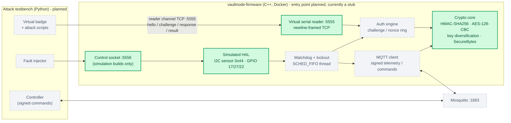

# VaultNode

**Encrypted RFID Access Controller & Server Room Telemetry Firmware: a simulated embedded-security project in C++ and OpenSSL, built and tested entirely in Docker.**

VaultNode is firmware for a server-room door node that authenticates RFID badges with a challenge-response protocol, watches temperature, humidity and an enclosure tamper switch, and reports signed telemetry over MQTT. There is no physical microcontroller: hardware is simulated so the whole system can be built, attacked and measured in containers. This repository is being built in phases, and this README describes only what exists today.

> **Project status: in progress (foundation, crypto core and simulated hardware layer complete).**
> Done: the protocol specification, a hardened CMake build, the cryptographic core, and the simulated hardware layer, each with tests.
> Not yet built: the main firmware (`main.cpp` is still a stub that links no HAL or crypto code), the authentication engine, MQTT, lockout logic and the attack testbench (see [Roadmap](#roadmap)).

---

## Architecture

The diagram shows the **planned** system. Solid green nodes are implemented; dashed grey nodes are planned and do not exist yet.



The green nodes exist as library code in `vaultnode_core` and run only under the test suite. `vaultnode-firmware` does not start them. Of the arrows shown, only control socket → HAL exists today; every arrow touching a grey node is still planned.

---

## What's implemented now

| Area | What exists | Where |
|---|---|---|
| **Protocol specification** | Wire formats, the normative verification order, the lockout state machine, MQTT signing rules, and known-answer test vectors that both the C++ firmware and the Python testbench must reproduce. | [`docs/PROTOCOL.md`](docs/PROTOCOL.md) |
| **Hardened build** | C++17 with extensions off, `-Wall -Wextra -Werror`, `-fstack-protector-strong`, `_FORTIFY_SOURCE=2`, PIE, full RELRO and BIND_NOW. Optional ASan/UBSan build. CMake refuses to configure on non-Linux hosts. | [`CMakeLists.txt`](CMakeLists.txt), [`firmware/CMakeLists.txt`](firmware/CMakeLists.txt) |
| **Crypto core** | HMAC-SHA256 and AES-128-CBC with PKCS7 padding (OpenSSL EVP APIs only), per-badge key diversification, constant-time comparison, CSPRNG wrapper, strict hex codec, the `SecureBytes` key container that wipes on destruction, and a single uniform decrypt-failure result. | [`crypto.hpp`](firmware/include/vaultnode/crypto.hpp), [`crypto.cpp`](firmware/src/crypto.cpp) |
| **Simulated GPIO** | Thread-safe pins: 17 (tamper input), 27 (relay output), 22 (status LED output). Edge callbacks stand in for interrupts: they fire only on a change, in order, and outside the internal lock, so a callback can safely call back into the GPIO. | [`hal_gpio.hpp`](firmware/include/vaultnode/hal_gpio.hpp), [`hal_gpio.cpp`](firmware/src/hal_gpio.cpp) |
| **Simulated I²C sensor** | A bus with an SHT3x-style sensor at 0x44. It returns raw 16-bit samples that use the SHT3x conversion formulas, with integer fixed-point conversion, seeded drift around 22.00 °C / 40.00 %RH, and exact overrides for threshold tests. | [`hal_i2c.hpp`](firmware/include/vaultnode/hal_i2c.hpp), [`hal_i2c.cpp`](firmware/src/hal_i2c.cpp) |
| **Virtual serial reader** | The TCP transport for the reader channel (default port 5555), built on a shared `poll()`-based line server. It handles partial reads and several lines in one read, closes on lines over 1024 bytes or after 10 s without a complete line, and holds at most 16 connections. It does framing only: no protocol messages are handled yet. | [`hal_serial.hpp`](firmware/include/vaultnode/hal_serial.hpp), [`hal_line_server.hpp`](firmware/include/vaultnode/hal_line_server.hpp), [`hal_line_server.cpp`](firmware/src/hal_line_server.cpp) |
| **Control socket** | `SimControlServer`: unauthenticated fault injection on default port 5556, implementing the `tamper`, `set_temp`, `set_humidity`, `clear_overrides` and `status` requests from [PROTOCOL.md §4.1](docs/PROTOCOL.md). It rejects malformed requests without crashing and is compiled only with `-DVAULTNODE_SIM_CONTROL=ON`. | [`hal_sim_control.hpp`](firmware/include/vaultnode/hal_sim_control.hpp), [`hal_sim_control.cpp`](firmware/src/hal_sim_control.cpp) |
| **Test suite** | A small header-only test harness. It covers protocol vectors, RFC 4231 and NIST SP 800-38A vectors, round trips, tampering and malformed input, plus the hardware layer over real loopback sockets. | [`firmware/tests/`](firmware/tests/) |

`vaultnode-firmware` itself is currently a **stub entry point**. It prints its version and its linked library versions (plus a warning banner in simulation builds), then exits. It links no HAL or crypto code, so it opens no sockets. The servers above run only inside the test binary.

---

## Threat model

| Threat | Mitigation | Status | Proven by |
|---|---|---|---|
| Ciphertext tampering in a badge response | Encrypt-then-MAC: HMAC-SHA256 over `uid ‖ fw_nonce ‖ iv ‖ ct` | **Implemented** (primitives) | `tamper_flip_any_ct_bit_breaks_mac`: flips every single bit of the ciphertext and requires the MAC to fail each time |
| Cloned badge UID | Per-badge keys derived from a master key: `K = HMAC(MASTER, label ‖ uid)`. A copied UID without the right key cannot produce a valid MAC. | **Implemented** (primitives) | `tamper_other_mac_inputs_break_mac` (cloned UID with the wrong master key), `protocol_6_1_key_diversification` |
| Padding oracle | Every decrypt failure returns the same `nullopt`, with the partial plaintext wiped and OpenSSL's error queue cleared. The protocol requires the MAC to be checked *before* decryption. | **Partial**: uniform failure implemented; MAC-before-decrypt ordering belongs to the planned auth engine | `tamper_bad_padding_single_failure` |
| Timing side channel on MAC comparison | `constant_time_equal` via `CRYPTO_memcmp` | **Implemented** | `constant_time_equal_semantics` (functional correctness only; timing has not been measured) |
| Key material left in memory | `SecureBytes`: non-copyable, wiped with `OPENSSL_cleanse` on destruction and move-assignment | **Implemented** | `secure_bytes_move_semantics` and `static_assert`s on copy/move traits (the wipe itself is not observable from a test) |
| Weak or failed randomness | `RAND_bytes` with its return value checked; the code throws (fails closed) rather than using predictable nonces | **Implemented** | `secure_random_lengths_and_uniqueness` |
| Malformed or wrong-length input | Strict hex (charset, even length, exact length) and length checks on every key, IV and ciphertext | **Implemented** | `hex_decode_strict`, `aes_rejects_bad_key_lengths`, `aes_rejects_bad_iv_lengths`, `aes_decrypt_rejects_bad_ciphertext_lengths`, `derive_rejects_bad_lengths` |
| Replay of a captured badge response | Single-use 5 s challenges, a seen-nonce ring buffer, a ±5 s timestamp window | Planned | — |
| Reader impersonation | Mutual authentication: the firmware returns a `proof` the badge verifies | Planned (the proof computation itself is vector-tested in `protocol_6_1_firmware_proof`) | — |
| MQTT command forgery / replay | HMAC-signed commands, strictly increasing `seq`, ±30 s timestamp window | Planned (signature computation is vector-tested in `protocol_6_2_signed_commands`) | — |
| Physical enclosure tamper | Tamper GPIO → high-priority lockout thread → relay and signed alert | Planned | — |
| Thermal sabotage | Temperature/humidity thresholds → latched lockout | Planned | — |

---

## Protocol overview

The full specification, including field formats, verification order and test vectors, is in **[docs/PROTOCOL.md](docs/PROTOCOL.md)**. In summary:

- **Reader channel (TCP 5555, newline-delimited JSON):** `hello` → `challenge` (16-byte nonce) → `response` (AES-128-CBC ciphertext + HMAC-SHA256) → `result`. The firmware checks the MAC first, then decrypts, then checks the nonce is single-use, then checks the timestamp is fresh. Every failure gets the same `"denied"` response, so an attacker learns nothing about which check failed.
- **MQTT (1883):** telemetry and commands are HMAC-signed over a canonical string, with separate command and telemetry keys. Signed telemetry uses no floats (temperatures are fixed-point integers), so C++ and Python produce byte-identical signatures.
- **Lockout:** a tamper or thermal breach latches the node into `LOCKED_OUT` until a signed `unlock` arrives, and the unlock is refused while the condition is still active.

---

## Quick start (what works today)

The project builds only on Linux (it uses `eventfd`/`SCHED_FIFO`), so everything runs in a throwaway container. From the repository root:

```bash
docker run --rm -v "$PWD":/src -w /src ubuntu:24.04 bash -c "\
  apt-get update && \
  apt-get install -y build-essential cmake pkg-config libssl-dev libmosquitto-dev nlohmann-json3-dev && \
  cmake -S . -B /tmp/build && cmake --build /tmp/build && \
  ctest --test-dir /tmp/build --output-on-failure && \
  /tmp/build/firmware/vaultnode_tests"
```

For the sanitizer build, configure with `-DVAULTNODE_SANITIZE=ON`. To leave the unauthenticated simulation control socket out of the build entirely, use `-DVAULTNODE_SIM_CONTROL=OFF`.

To regenerate every metric in this README, run `scripts/measure_foundation.sh`. It also runs in a throwaway container. There is no Docker Compose stack or Makefile yet; both are on the roadmap.

---

## Project structure

```
.
├── .github/workflows/          (empty; CI is planned)
├── attack-testbench/           Python testbench (placeholder files only)
│   ├── tests/
│   ├── vaultnode_sim/__init__.py
│   ├── Dockerfile              (placeholder)
│   └── requirements.txt
├── benchmarks/
│   └── foundation_metrics.txt  raw output behind every number in this README
├── docs/
│   └── PROTOCOL.md             protocol specification + test vectors
├── firmware/
│   ├── include/vaultnode/
│   │   ├── build_info.hpp
│   │   ├── control_socket.hpp  control port constant + startup banner (simulation builds only)
│   │   ├── crypto.hpp
│   │   ├── hal_fd.hpp          RAII file descriptor
│   │   ├── hal_gpio.hpp
│   │   ├── hal_i2c.hpp         I2C bus + SHT3x-style sensor
│   │   ├── hal_line_server.hpp newline-framed TCP server
│   │   ├── hal_serial.hpp      virtual serial reader
│   │   └── hal_sim_control.hpp control server (simulation builds only)
│   ├── src/
│   │   ├── build_info.cpp
│   │   ├── control_socket.cpp  startup banner (simulation builds only)
│   │   ├── crypto.cpp
│   │   ├── hal_gpio.cpp
│   │   ├── hal_i2c.cpp
│   │   ├── hal_line_server.cpp
│   │   ├── hal_serial.cpp
│   │   ├── hal_sim_control.cpp (simulation builds only)
│   │   └── main.cpp            (stub entry point; links no HAL or crypto code)
│   ├── tests/
│   │   ├── test_build_info.cpp
│   │   ├── test_crypto.cpp
│   │   ├── test_hal_gpio.cpp
│   │   ├── test_hal_i2c.cpp
│   │   ├── test_hal_serial.cpp
│   │   ├── test_hal_sim_control.cpp  (simulation builds only)
│   │   ├── test_harness.hpp
│   │   ├── test_main.cpp
│   │   └── test_net.hpp        loopback TCP client for the socket tests
│   ├── CMakeLists.txt
│   └── Dockerfile              (placeholder)
├── mosquitto/mosquitto.conf    (placeholder)
├── scripts/
│   └── measure_foundation.sh   regenerates benchmarks/foundation_metrics.txt (in Docker)
├── .env.example                dev-only, deliberately fake keys
├── CMakeLists.txt
├── docker-compose.yml          (placeholder)
├── LICENSE                     MIT
└── README.md
```

---

## Security design decisions

- **Encrypt-then-MAC.** The MAC covers the ciphertext and the protocol requires checking it before decryption. Unauthenticated ciphertext is never decrypted, which rules out padding-oracle attacks by design rather than by careful error handling.
- **Per-badge key diversification.** `K_enc` and `K_mac` are derived from a master key and the badge UID. A cloned UID is useless without that badge's keys, and leaking one badge's keys exposes neither other badges nor the master key.
- **Constant-time comparisons.** Every MAC, signature and proof is compared with `CRYPTO_memcmp`. A length mismatch returns early, because lengths are public, but the content comparison never does.
- **Fail closed.** If the CSPRNG or HMAC fails, the code throws instead of continuing with predictable or empty values. Decryption has one failure result with no reason attached.
- **Key hygiene.** `SecureBytes` cannot be copied, never reallocates, and is wiped with `OPENSSL_cleanse`. Partly decoded hex is wiped when it's rejected. Text cannot be passed implicitly where raw bytes are expected, which blocks the "passed the hex string instead of the decoded bytes" bug.
- **The control socket is compiled out of non-simulation builds.** The fault-injection socket (port 5556) is unauthenticated by design. With `-DVAULTNODE_SIM_CONTROL=OFF`, its source files are not compiled at all, and its headers fail with `#error` if anything includes them. A symbol and string search of that build's firmware binary, test binary and library finds 0 matches, while the same search finds the code in the default build. Both servers also bind to `127.0.0.1` by default. The address is already configurable in code, but `VAULTNODE_BIND_ADDR` won't be read until the main firmware is built.
- **FORTIFY handling.** Ubuntu's GCC already sets `_FORTIFY_SOURCE=3`, so the build undefines it before setting `=2` (otherwise `-Werror` fails on the redefinition). `-O2` is forced because FORTIFY needs optimization. FORTIFY is turned off in sanitizer builds, where its checked libc functions would bypass ASan's checks.

---

## Measured results

All numbers come from [`benchmarks/foundation_metrics.txt`](benchmarks/foundation_metrics.txt), which [`scripts/measure_foundation.sh`](scripts/measure_foundation.sh) produces in a throwaway `ubuntu:24.04` container (aarch64, GCC 13.3.0, OpenSSL 3.0.13, Valgrind 3.22.0, Cppcheck 2.13.0).

- **Tests:** 90 tests, 0 failed, in both the default and the ASan/UBSan builds; 76 tests, 0 failed, in the `-DVAULTNODE_SIM_CONTROL=OFF` build, which leaves out the 14 control-socket tests. CTest shows "1 test" because the whole test binary is registered as a single CTest entry; the 90 cases (23 in `test_crypto.cpp`, 5 in `test_build_info.cpp`, 10 in `test_hal_gpio.cpp`, 10 in `test_hal_i2c.cpp`, 28 in `test_hal_serial.cpp`, 14 in `test_hal_sim_control.cpp`) run inside it.
- **Known-answer assertions:** 17 = 10 PROTOCOL.md §6 + 6 RFC 4231 + 1 NIST SP 800-38A F.2.1 (a 4-block vector).
- **Control server compiled out:** 0 symbol or string matches across the firmware binary, test binary and library in the `-DVAULTNODE_SIM_CONTROL=OFF` build. In the default build the same search matches the test binary and library (13 symbols each), and the firmware binary only on its startup banner. The firmware binary's zero is weak evidence on its own, because it contains no HAL code in either build.
- **Hardening** (`checksec` + `readelf`): Full RELRO, canary found, NX enabled, PIE enabled and BIND_NOW on both binaries. FORTIFY is yes on both, with 1 of 2 fortifiable calls fortified in `vaultnode-firmware` (the stub) and 3 of 8 in `vaultnode_tests` (the binary that contains the crypto and HAL code).
- **Binary size (Release):** 70.5 KB unstripped, 66.0 KB stripped. This is the stub entry point: `main.cpp` links no HAL or crypto code (0 `vaultnode::hal::` and 0 `vaultnode::crypto::` symbols), so it is **not** representative of the finished firmware.
- **Valgrind** (non-sanitized test binary, `--leak-check=full --error-exitcode=1`): 90 tests, 0 failed under Valgrind; `ERROR SUMMARY: 0 errors`; definitely, indirectly and possibly lost: 0 bytes; **still reachable: 721 bytes in 12 blocks**. All 12 loss records pass through `hmac_sha256`, which fetches the HMAC algorithm from OpenSSL. The code deliberately caches that handle for the life of the process and never frees it. It is still referenced at exit, so it is not a leak. With `--track-fds=yes`, 3 file descriptors are open at exit, all of them standard streams.
- **cppcheck** (`--enable=all --inconclusive --suppress=missingIncludeSystem`; counts exclude cppcheck's own summary line):
  - **Exact command:** 17 findings, 0 errors or warnings. 10 are `missingInclude`, because the command doesn't pass the project include path. 6 are `unusedFunction`, because the tests that call those functions weren't scanned. 1 is `functionConst` on `ConnectionIo::service`, a style suggestion that has not been applied.
  - **Re-run with `-I firmware/include`:** 15 findings, 0 errors or warnings: 3 `noExplicitConstructor` on `ByteView`, which is intentional (see the design notes), 11 `unusedFunction`, and the same 1 `functionConst`.
- **Size:** 27 C++ files; 2467 lines of code (cloc, excluding blanks and comments), 3119 physical lines. Of the code lines, 1040 are firmware (`src` + `include`) and 1427 are tests; the HAL sources account for 728 of the firmware lines.

---

## Limitations

- **Simulated hardware.** No microcontroller, RFID antenna, I²C bus or GPIO exists. The GPIO, I²C sensor and reader transport are software models, and the sensor returns raw 16-bit samples rather than modelling the real SHT3x command and CRC protocol.
- **Dev-only keys.** `.env.example` holds public keys that decode to `DEV-ONLY-…-DO-NOT-USE`. There is no secure element or TPM. A real deployment would keep the master key inside one and derive badge keys there.
- **Anonymous broker in dev (planned).** The planned Compose broker is a plaintext listener on an internal network; integrity comes from application-layer HMACs, not TLS or broker ACLs.
- **Unauthenticated control socket.** Anyone who can reach the port can inject faults. It is intended for simulation only and compiled out otherwise. It is implemented and tested, but the stub firmware doesn't start it, and until the lockout logic exists it changes only the simulated pins and sensor: tamper doesn't drive the relay, and `state` reports `NORMAL` unless the relay is set directly.
- **Container timings are not MCU timings.** Any latency figure from this project will describe a Linux container on a desktop CPU, not a microcontroller.
- **No live node yet.** The crypto core and hardware layer are implemented and run only under the tests. No protocol messages are handled over the network yet, and no attack has been run against a live node.
- **Constant-time behaviour is assumed, not measured.** It relies on OpenSSL's `CRYPTO_memcmp`; this project has not run any timing analysis.

---

## Roadmap

- [x] Protocol specification with known-answer test vectors
- [x] Hardened CMake build (warnings as errors, FORTIFY, stack protector, PIE, full RELRO, sanitizer option)
- [x] Crypto core with known-answer, tamper and malformed-input tests
- [x] Simulated hardware abstraction layer (I²C sensor, tamper GPIO, lockout relay, control socket)
- [ ] Auth engine (challenge/response, nonce ring, uniform denial) and watchdog/lockout thread
- [ ] Main firmware entry point (start the HAL and services, read configuration such as `VAULTNODE_BIND_ADDR`)
- [ ] MQTT bus: signed telemetry, verified commands, persisted state
- [ ] Attack testbench: replay, forgery, cloned UID, tamper and thermal scenarios
- [ ] Docker Compose stack (firmware, Mosquitto, testbench)
- [ ] CI workflow
- [x] Foundation measurement script (`scripts/measure_foundation.sh`)
- [ ] Runtime benchmark script (handshake and lockout latency; updates the table below)

---

## License

MIT, see [LICENSE](LICENSE).

---

## Resume Metrics & Benchmarks (For CV Integration)

Measured values are from [`benchmarks/foundation_metrics.txt`](benchmarks/foundation_metrics.txt), generated by `scripts/measure_foundation.sh`. Rows marked "Not yet measured" depend on components that don't exist yet.

<!-- BENCH:START -->
| Metric | Value | Source / phase |
|---|---|---|
| Unit tests passed (default build) | 90 / 90 | foundation_metrics.txt §1a |
| Unit tests passed (ASan + UBSan + LeakSanitizer build) | 90 / 90 | foundation_metrics.txt §1b |
| Unit tests passed (`VAULTNODE_SIM_CONTROL=OFF` build) | 76 / 76 | foundation_metrics.txt §1e |
| Control-server symbol/string matches in the OFF build | 0 (firmware binary, test binary and library) | foundation_metrics.txt §1e |
| Known-answer assertions | 17 (10 PROTOCOL.md §6, 6 RFC 4231, 1 NIST SP 800-38A) | foundation_metrics.txt §1d |
| Binary hardening verified | PIE, Full RELRO, BIND_NOW, stack protector (canary found) and NX on both the stub firmware binary and the test binary | foundation_metrics.txt §2, §2b |
| FORTIFY coverage (partial) | 1 of 2 fortifiable calls in the stub firmware binary, 3 of 8 in the test binary | foundation_metrics.txt §2, §2b |
| Firmware binary size (Release; stub `main.cpp` that links no HAL or crypto code, not representative of the final firmware) | 66.0 KB stripped / 70.5 KB unstripped | foundation_metrics.txt §3 |
| Valgrind memcheck (test binary) | 0 errors; 0 bytes definitely/indirectly/possibly lost; 721 bytes still reachable (cached OpenSSL handle) | foundation_metrics.txt §4 |
| cppcheck `--enable=all --inconclusive` | 0 errors/warnings; 17 style/information findings without the include path, 15 style findings with it | foundation_metrics.txt §5 |
| Lines of C++ (src + include + tests) | 2467 code lines (cloc) across 27 files: 1040 firmware (728 of them HAL), 1427 tests | foundation_metrics.txt §6 |
| Badge handshake time (`verify_us`) | Not yet measured | Auth engine + benchmark script |
| Replay / forged-HMAC rejection rate | Not yet measured | Attack testbench |
| Memory footprint under load | Not yet measured | Compose stack + benchmark script |
| MQTT command publish-to-lockout latency | Not yet measured | MQTT bus + benchmark script |
| Tamper-interrupt-to-lockout latency | Not yet measured | Watchdog/lockout + benchmark script |
<!-- BENCH:END -->

**Resume bullets**

- Engineered the cryptographic core of VaultNode, an in-progress, Docker-simulated encrypted RFID access-control firmware. It uses OpenSSL EVP for HMAC-SHA256 encrypt-then-MAC, AES-128-CBC and per-badge key diversification, with constant-time comparison and key wiping. The project's 90 of 90 unit tests pass, including 17 known-answer assertions against RFC 4231, NIST SP 800-38A and the project's own protocol vectors.
- Built the simulated hardware layer for the same project in 728 lines of C++: thread-safe GPIO whose edge callbacks run outside internal locks, an I²C temperature/humidity sensor model with fixed-point conversion, and newline-framed `poll()`-based TCP servers using RAII file descriptors. The layer runs under the test suite only, because the firmware entry point is still a stub that does not link it. Tests pass in builds with the fault-injection server (90 of 90) and without it (76 of 76), and a symbol and string search of the latter finds 0 matches for that server's code.
- Hardened the build of this simulated, in-progress firmware project, verifying PIE, full RELRO, BIND_NOW, stack protector and NX with checksec and readelf, on both the stub firmware binary and the test binary that contains the crypto and hardware-layer code. FORTIFY coverage is partial: 1 of 2 fortifiable calls in the stub and 3 of 8 in the test binary. The test suite ran with 0 Valgrind memory errors, 0 bytes definitely lost, and 0 failures across 90 tests under AddressSanitizer and UndefinedBehaviorSanitizer.
